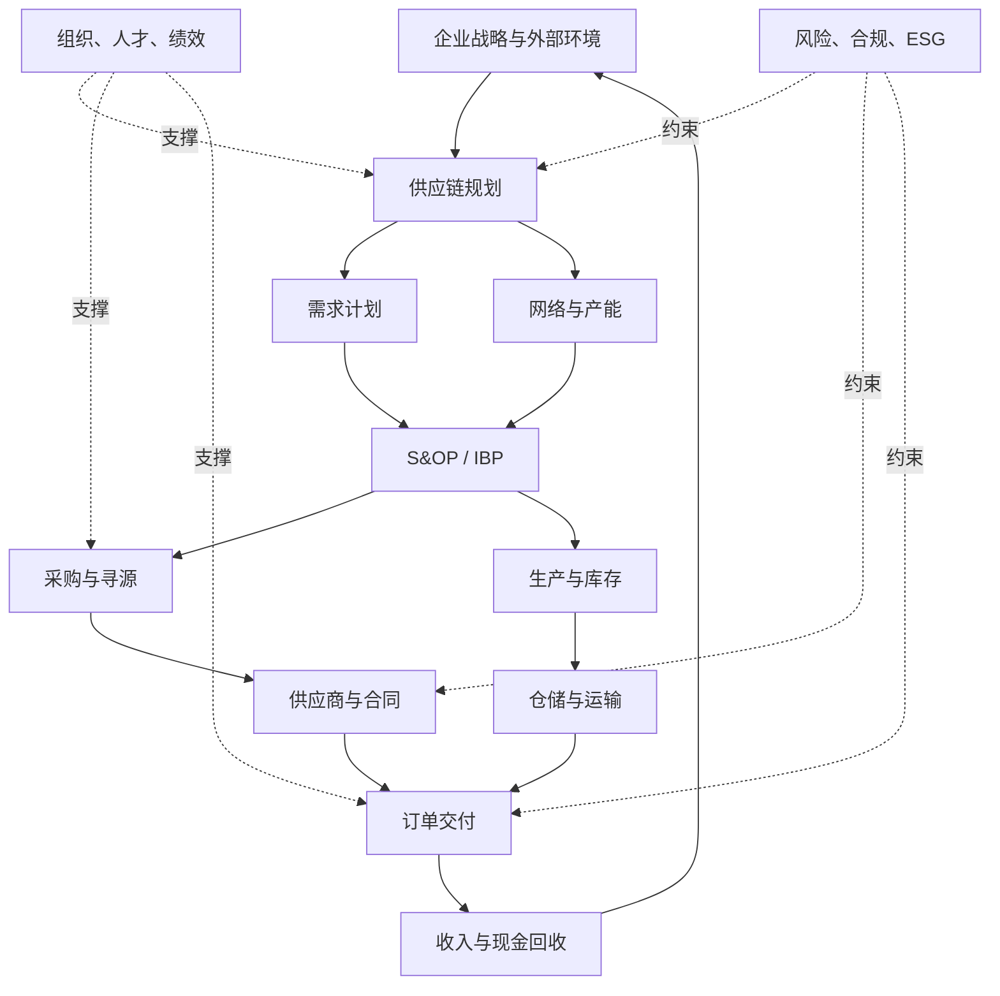

# 知识地图

## 主线关系

## 五个领域入口

| 领域 | 核心问题 | 入口 |
|---|---|---|
| 总框架 | 供应链整体如何运转？ | [[10_框架/端到端供应链]] |
| 采购 | 如何以合适的总成本获得可靠外部资源？ | [[20_采购管理/采购管理MOC]] |
| 规划 | 如何设计并协调未来的供需？ | [[30_供应链规划/供应链规划MOC]] |
| 运作 | 如何把承诺稳定地兑现？ | [[40_供应链运作/供应链运作MOC]] |
| 组织领导 | 如何让跨部门、跨组织协作发生？ | [[50_组织与领导力/领导力MOC]] |

## 高频连接

- [[20_采购管理/第02章-品类管理]] ↔ [[20_采购管理/卡拉杰克矩阵]] ↔ [[20_采购管理/供应商全生命周期]]
- [[20_采购管理/第03章-寻源管理]] ↔ [[80_模板/供应商评估模板]] ↔ [[60_诊断工具/风险登记模板]]
- [[30_供应链规划/第03章-供应链集成与优化]] ↔ [[30_供应链规划/S&OP与IBP]] ↔ [[80_模板/S&OP会议模板]]
- [[30_供应链规划/第04章-供应链成本管理]] ↔ [[20_采购管理/总拥有成本TCO]] ↔ [[10_框架/供应链三重目标]]
- [[40_供应链运作/第02章-客户需求与交付]] ↔ [[40_供应链运作/订单到收款]] ↔ [[30_供应链规划/供应链金融]]
- [[40_供应链运作/第03章-库存管理基础]] ↔ [[40_供应链运作/库存补货模型]] ↔ [[60_诊断工具/库存健康诊断]]
- [[40_供应链运作/第05章-生产运作]] ↔ [[40_供应链运作/精益生产与OEE]] ↔ [[40_供应链运作/第08章-质量管理]]
- [[50_组织与领导力/第07章-组织绩效管理]] ↔ [[60_诊断工具/指标体系树]] ↔ [[50_组织与领导力/第09章-供应链风险管理]]

## 概念成熟度

阅读一个概念时，连续追问四层：

1. **定义**：它到底是什么，不是什么？
2. **机制**：它通过什么因果链影响结果？
3. **决策**：它帮助谁在什么时点做什么选择？
4. **边界**：它在哪些条件下会失效？

如果只能回答第一层，说明还停留在术语记忆。

