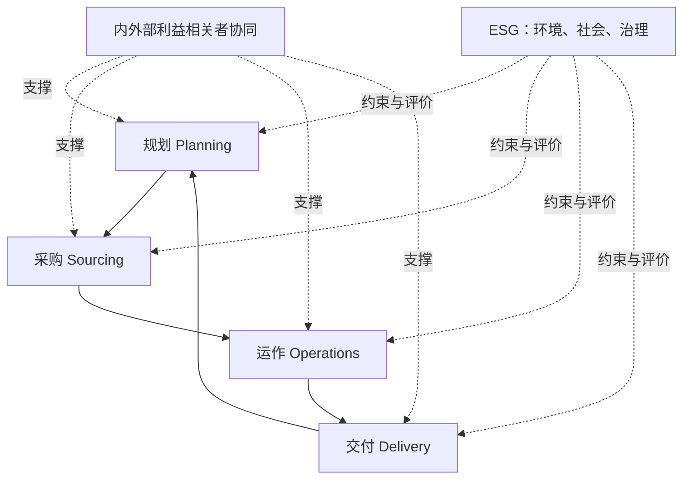

# SCOP 模型

> [!summary] 一句话
> SCOP 把供应链概括为规划、采购、运作、交付四个运作环节，并以利益相关者协同和 ESG 作为贯穿基础。

## 结构

## 四个运作环节

| 环节 | 主要任务 | 关键输出 |
|---|---|---|
| 规划 | 理解环境、设计网络、协调供需、配置资源 | 可执行的需求、供应、库存与产能计划 |
| 采购 | 定义需求、选择来源、谈判、签约、管理供应商 | 可靠、合规、总成本合理的供应 |
| 运作 | 生产产品、提供服务、管理库存与质量 | 符合质量、成本和时间要求的产出 |
| 交付 | 订单管理、仓储、运输、交付与收款 | 客户承诺兑现与现金回收 |

## 两个基础

### 利益相关者协同

包括内部销售、研发、财务、制造、采购、物流、法务，以及外部供应商、客户、渠道商、投资人和监管机构。协同不是“多发邮件”，而是共享目标、规则、数据、会议节奏和争议升级机制。

### ESG

环境、社会与治理不是交付后的公关事项，而是计划、供应来源、生产方式和物流交付的选择约束。典型问题包括碳排放、劳工权益、供应商合规、反贿赂和数据责任。

## 使用方式

1. 画出企业的 P-S-O-D 责任地图。
2. 标记每个环节的输入、输出和跨部门接口。
3. 找出“有流程但无责任人”“有指标但无共同目标”的接口。
4. 检查协同机制和 ESG 要求是否真正进入决策标准。

## 与其他框架的关系

- [[10_框架/SCOR模型]] 更聚焦流程分类和绩效，SCOP 更适合作为 SCMP 教材的整体语言。
- [[10_框架/端到端供应链]] 强调产品、信息、资金和决策四类流。
- [[10_框架/战略匹配]] 检查 SCOP 各环节是否支持同一竞争战略。

## 来源

模型来自四本 SCMP 教材的统一定义。参见 [[90_来源与维护/来源档案/采购管理来源]] PDF 第 8 页及各书导言；本页的解释和诊断方式是知识库综合。

