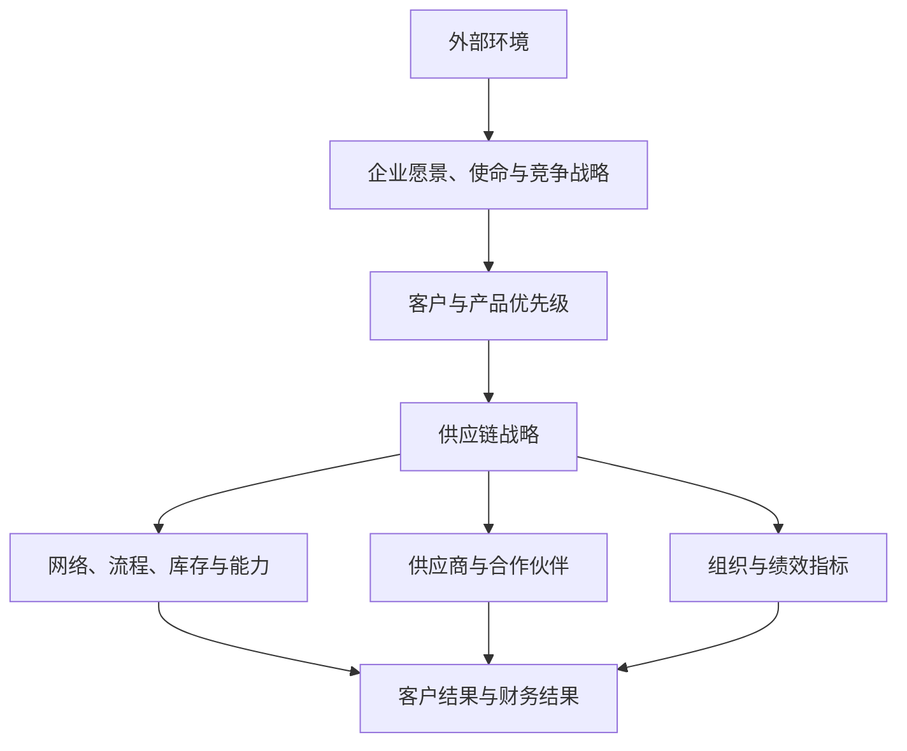

# 战略匹配

> [!summary] 一句话
> 战略匹配不是“供应链支持战略”的口号，而是客户优先级、供应链能力、组织结构和绩效指标之间的因果一致性。

## 匹配链条

## 四个一致性检查

### 1. 价值主张一致性

- 成本领先战略要求标准化、规模、效率与稳定供应；
- 差异化战略要求创新、柔性、响应速度与服务能力；
- 聚焦战略要求针对特定客户群配置不同供应链。

### 2. 客户优先级一致性

客户真正愿意为什么付费：价格、速度、可得性、定制、质量、服务还是合规？不同客户群可以有不同的供应链策略，但必须明确服务边界。

### 3. 能力一致性

供应链网络、库存位置、产能柔性、供应商关系和信息系统是否支持承诺？战略中写“快速响应”，但审批链长、库存集中、供应商单一，就是能力失配。

### 4. 指标一致性

采购只考核单价、生产只看设备利用率、销售只考核收入，组织必然产生局部优化。战略匹配要求端到端指标存在因果关系，而不是彼此抵消。

## 常用工具

- [[30_供应链规划/供应链环境分析]]：PESTEL、五力、SWOT、价值链和标杆；
- [[10_框架/SCOR模型]]：描述流程与绩效；
- [[60_诊断工具/指标体系树]]：把战略转化为指标；
- [[50_组织与领导力/第02章-战略与目标]]：从愿景使命到行动。

## 失配的典型症状

- 销售承诺不受供应能力约束；
- 新品开发不考虑采购提前期与供应商能力；
- 降本项目使供应风险或总成本上升；
- 网络和库存策略按历史平均需求设计，无法应对波动；
- 各部门指标都“完成”，客户结果却恶化。

## 来源

参见 [[90_来源与维护/来源档案/供应链规划来源]] 第 1-2 章、[[90_来源与维护/来源档案/供应链领导力来源]] 第 2 章和 [[90_来源与维护/来源档案/供应链运作来源]] 第 1 章。

