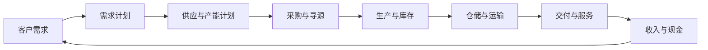

# 端到端供应链

> [!summary] 一句话
> 端到端供应链不是“采购—生产—物流”三个部门的串联，而是围绕客户价值，对产品流、信息流、资金流和决策权进行跨组织协调。

## 一条主链

## 四类流

| 流 | 核心问题 | 常见断点 |
|---|---|---|
| 产品/服务流 | 什么在何时、何地、以何形态流动？ | 库存位置错误、齐套不足、运输延误 |
| 信息流 | 需求、库存、产能、承诺是否一致？ | 预测口径不同、数据滞后、信息孤岛 |
| 资金流 | 现金何时流出、何时回收？ | 长账期、库存占资、采购付款与交付脱节 |
| 决策流 | 谁在什么阈值内做决定？ | 权责不清、会议无授权、例外升级慢 |

## 端到端管理的五个原则

1. **以客户结果定义绩效**：不是采购 cheapest、生产 utilization 最高、仓库库存最低，而是客户所需的服务、成本与现金结果同时可持续。
2. **用同一套需求口径协同**：销售机会、订单、预测、生产计划和采购计划必须能相互追溯。
3. **在正确的解耦点放置库存**：成品、半成品、原材料库存是不同响应策略，不是同一种“存货”。
4. **让指标存在因果关系**：库存周转改善不能以缺货和失约为代价。
5. **把例外管理显性化**：端到端协同不是每天开会，而是定义异常触发条件、责任人和升级路径。

## 诊断端到端问题

先画“订单承诺时间线”：

1. 客户何时下单或提出预测？
2. 销售何时确认承诺？
3. 计划何时锁定供应？
4. 采购何时下单、供应商何时交付？
5. 生产何时完成、质量何时放行？
6. 仓库与物流何时交付？
7. 客户何时验收、企业何时开票和收款？

把每一段实际耗时和不确定性标出来，通常可以快速看到真正的瓶颈在“部门内部效率”之外。

## 连接

- 流程框架：[[10_框架/SCOP模型]]、[[10_框架/SCOR模型]]
- 目标权衡：[[10_框架/供应链三重目标]]
- 需求协同：[[30_供应链规划/S&OP与IBP]]
- 采购闭环：[[20_采购管理/采购流程]]
- 现金闭环：[[40_供应链运作/订单到收款]]
- 综合诊断：[[60_诊断工具/端到端诊断问题库]]

## 来源

综合自 [[90_来源与维护/来源档案/供应链运作来源]] 第 1 章、[[90_来源与维护/来源档案/供应链规划来源]] 第 3 章和 [[90_来源与维护/来源档案/供应链领导力来源]] 第 6 章。端到端视图和诊断问题是对原书流程内容的再组织。

