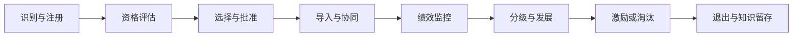

# 供应商全生命周期

供应商管理应从“入库名单”转为有进入、发展和退出规则的动态组合。

## 各阶段控制点

| 阶段 | 关键问题 | 证据 |
|---|---|---|
| 识别 | 市场上有哪些可替代来源？ | 市场地图、供应商长名单 |
| 资格 | 是否具备基本合法与能力条件？ | 财务、合规、质量体系、产能 |
| 选择 | 哪家方案最符合品类策略？ | 评标记录、TCO、风险 |
| 导入 | 能否稳定衔接流程与系统？ | 试产、验收、培训、数据接口 |
| 绩效 | 是否持续满足当前和未来要求？ | 质量、交付、成本、创新、ESG |
| 发展 | 哪些能力值得共同投资？ | 差距分析、改善项目、联合路线图 |
| 退出 | 如何退出而不破坏供应？ | 替代认证、库存、知识转移、终止条款 |

## 关系分层

不建议对所有供应商采用同一关系：

- 交易型：标准化、低风险，重效率；
- 连续型：稳定合作，重流程衔接；
- 伙伴型：长期协作，重信息共享与共同改善；
- 战略联盟：共同投资、创新和风险共担；
- 并购/股权：仅适合战略控制要求极高的场景。

关系升级必须有业务理由和治理机制，不能只靠“关系好”。

## 评价原则

- 指标与品类策略一致；
- 质量、交付、成本、风险等多维平衡；
- 结果与过程并重；
- 定期评估与事件触发评估结合；
- 评估结果用于资源分配、改善、激励或退出。

## 连接

- [[20_采购管理/第03章-寻源管理]]
- [[20_采购管理/第09章-采购与供应商绩效]]
- [[20_采购管理/第05章-间接采购]]
- [[50_组织与领导力/第05章-伙伴关系管理]]
- [[60_诊断工具/风险登记模板]]

## 来源

综合自 [[90_来源与维护/来源档案/采购管理来源]] 第 3、5、9 章和 [[90_来源与维护/来源档案/供应链运作来源]] 第 7 章。

