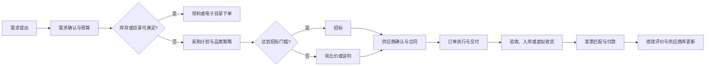

# 第 5 章 间接采购

> [!summary] 本章主线
> 间接采购不是“把每张小订单管得更细”，而是用品类、需求、组织、流程和供应商全生命周期治理分散支出：先让需求变得可见和可计划，再用合适的采购渠道聚合规模，最后把供应商从准入、交付、绩效到退出纳入同一套控制闭环。

## 教材精读（自足版）

> [!info] 本章学习目标
> 学完本章，应当能够：区分直接采购与间接采购；解释间接采购为什么 SKU 多、金额分散却仍然重要；按品类树和 ABC 分类设计策略；判断常规、杠杆、关键和瓶颈类间接物料应采用的采购方式；设计需求、组织、跨部门、系统和供应商全生命周期管理机制；用指标识别“采购外支出”和合同价值漏损。

### 1. 章节结构与考试地图

| 原书节 | 原书页 / PDF 页 | 必须掌握的内容 | 常见考法 |
|---|---|---|---|
| 第 1 节 间接采购管理概述 | 139-146 / 155-162 | 定义与范围、标的分类、行业差异、标的特点、管理难点、典型流程和具体流程 | 判断直接/间接；说明间接采购为什么难管；选择项目、设备、材料、服务流程 |
| 第 2 节 间接采购管理优化 | 147-160 / 163-176 | 品类树、编码、需求预测、组织架构、流程、Kraljic、跨部门协同、业务平台、系统架构 | 设计品类策略；判断组织模式；指出协同和流程控制点 |
| 第 3 节 间接采购最佳管理实践 | 161-167 / 177-183 | 品类管理、编码、ABC、需求动态分析、MRO 集成采购、集成采购与集成供应 | 用案例选择最佳实践；比较自购、框架、集成采购 |
| 第 4 节 间接采购供应商全生命周期管理 | 168-176 / 184-192 | 供应商库、评估选择、交付、关系、绩效、退出；分类、评价、控制流程 | 设计供应商准入和退出；识别“扶优劣汰”与全流程控制 |

本章在采购流程中的位置是“直接生产之外的全部支持性支出”。它常被误认为金额小、风险低，但间接采购的 SKU 和供应商数量很大，需求分散、计划性弱，且质量问题会直接影响员工、设施、IT、营销和正常运营。原书引用企业实践指出，间接采购 SKU 约占采购总数的 80%，因此不能只按金额排序管理。（原书第 139-140 页；PDF 第 155-156 页）

### 2. 核心概念、定义与分类

#### 2.1 直接采购与间接采购

| 维度 | 直接采购 | 间接采购 |
|---|---|---|
| 用途 | 直接进入产品、服务交付或主营运作 | 支持生产、销售、办公和正常运营，不直接构成最终交付物 |
| 典型对象 | 原材料、半成品、包装材料、第三方物流等主营投入 | MRO、IT、营销、专业服务、设施、能源、行政、物流支持等 |
| 需求来源 | 生产计划、BOM、MRP、项目计划 | 使用部门临时或周期性提出，常不进入 BOM |
| 需求特征 | 规格较明确，数量与计划关联 | 品类繁杂、规格不清、需求时间和数量不确定 |
| 管理重点 | 成本、质量、交付、供应连续性和供应商能力 | 需求治理、标准化、聚合、效率、合规、体验和全生命周期 |
| 常见组织 | 集中采购或品类采购 | 历史上分散在各部门，逐步转向混合型品类组织 |

间接采购的定义可以概括为：企业从外部获得支持产品生产、销售及维持正常运营的产品和服务，而这些产品和服务不直接包含在交付给最终客户的产品或服务中。服务型企业的“生产”可能是办公、门店、平台或专业服务运作，因此其大量支出也可归入间接采购。（原书第 139 页；PDF 第 155 页）

#### 2.2 间接采购的典型标的

原书把常见间接采购标的归纳为以下类别，企业可在此基础上继续细分：

| 大类 | 典型内容 | 采购难点 |
|---|---|---|
| MRO 与生产运维 | 备品备件、维修服务、工具、消耗品 | 需求不连续、关键备件停线风险高、供应商分散 |
| 基建设施 | 厂房、生产线建造、配套设施 | 项目周期长、技术接口多、变更和验收复杂 |
| 能源消耗 | 电力、原煤、液化天然气 | 价格波动、计量和结算复杂、政策影响 |
| IT 软硬件与服务 | 硬件、软件、系统开发、云服务 | 技术更新快、锁定效应、数据安全和知识产权 |
| 市场营销 | 设计、调研、公关、促销品、媒体 | 效果难预先验证、成果主观、供应商创意差异大 |
| 专业服务 | 咨询、外包、仓储物流、招聘、培训、餐饮 | 范围难定义、服务同步发生、质量依赖人员 |
| 行政办公 | 物业、租车、环境维护、会议接待 | 高频小额、需求分散、容易绕过采购 |
| 物流运输 | 货代、报关、仓储配送 | 时效、关务、破损、旺季运力和多段责任 |

行业会改变间接采购的内容。机械制造企业更关注生产线、自动化设备、工装和维修备件；石油化工更关注装置、管道、阀门、仪表和安全；电信和电力企业既有自用采购，也有网络和输变电项目采购；快消品企业则把媒体、市场调研和促销品放在重要位置。（原书第 141-142 页；PDF 第 157-158 页）

#### 2.3 间接采购标的的四个特征

1. **需求不清晰**：需求方可能只描述“要一个更好的系统”或“要提升品牌”，没有说明业务结果、范围和验收。
2. **标准化程度低**：不同部门使用不同品牌、规格、服务等级和口径，难以合并需求。
3. **数量不确定**：消耗品、维修、项目和活动需求受生产、季节、客户和突发事件影响。
4. **时间不确定**：需求常在临近使用时才提出，采购提前期短，容易变成紧急采购。

这些特征会形成七个管理难点：采购人员专业化不足、分散采购难以形成规模、系统化程度低、流程透明度低、供应商难以对症管理、采购提前期短、议价能力弱。（原书第 143-144 页；PDF 第 159-160 页）

#### 2.4 三个容易混淆的概念

- **集成采购（Integrated Purchasing）**：把采购当成独立的服务和能力来经营，由集成采购服务商提供采购、仓储、配送等组合服务。
- **集成供应（Integrated Supplier）**：以集成供应商为核心组成供应商联盟，用长期伙伴关系共同满足客户需求。
- **MRO 集成采购**：面向维护、维修和运营物料，把计划、采购、仓储、配送、库存和供应商管理整合起来，常以区域中心库存和现场服务降低客户库存与缺货风险。

### 3. 逐节精读

#### 第 1 节：间接采购管理概述

**1. 间接采购的目标是多元的。** 直接采购常把降本作为首要目标；间接采购还要兼顾效率、员工体验、运营安全、产能保障、现金流、合规和供应连续性。判断间接采购方案时，不能只比较单价，而要看总成本、管理成本、交付时间、使用部门的生产效率和风险。

**2. 标的划分服务于采购策略。** 原书把间接采购标的分为 MRO 物料和服务，以及经营业务和业务支持等类别，并强调划分应能吸引供应商、发挥供应商优势、降低成本、保证供货时间和质量，同时让招标或采购具有可操作性。标的划分不是财务科目分类，而是为了形成可竞争的采购包。

**3. 典型流程。** 消耗类和资本类间接物料的典型链路是：

`请购部门提出申请 → 确认需求 → 采购部门编制计划 → 确认采购 → 询比价或招标 → 确认供应商 → 磋商合同 → 确认合同 → 执行合同 → 仓储验收 → 财务收票付款`

请购单应把需求具体化并经过管理层批准；采购计划应汇总需求并平衡库存、在途和未满足量；标准产品可以使用模板合同降低谈判与法律成本；验收必须按合同标准执行；发票和付款要在约定时限内完成。出现不良品时，采购部门需要协调退换、索赔或补救。（原书第 145-146 页；PDF 第 161-162 页）

**4. 不同标的要改造流程。**

- **项目类**：以项目进度计划为起点，先做自制/外购分析，再决定采购对象、数量、时间和方式，并把成本、质量和进度控制嵌入项目。
- **设备类**：先做价值、需求和投入产出分析；大型设备还要做市场调查、供应商资质审核、资格认证和必要的实地考察；低价值设备可以简化流程。
- **材料类**：依据工程进度、消耗定额、库存和需求计划提出名称、规格、数量、时间、使用要求、验收和质量要求；采购部门再选择询比价、招标或框架方式。
- **服务类**：通常是请购、询价、比价或议价、签合同、合同审核并生效五步；重点是把服务目的、预算、范围、供应商资质和成果验收写清楚。

#### 第 2 节：间接采购管理优化

**1. 品类树是优化的起点。** 品类树按产品和服务特点，把间接支出分为一阶、二阶、三阶结构。好的品类树应满足三个条件：同一品类有相似供应市场；可以使用相近的采购策略；可以归集支出和供应商绩效。常见的树包括生产运维、基建设施、能源、IT、营销、专业服务、行政办公和物流运输。

**2. 编码是数据治理的基础。** 物料编码应追求“一物一码”，同时兼顾物料属性和管理属性。原书提出可以用“层次码 + 特征码”表达大类、中类、小类和材质、规格等特征，并由技术、采购、财务共同制定规则。常见误区是直接把图号当编码、让编码承载供应商和仓库等过多信息、把规则只交给技术部门。编码应支持请购、验收、领用、盘点、供应商分析、合同和财务核算，而不是变成一张无法维护的长字符串。（原书第 147-149、163-164 页；PDF 第 163-165、179-180 页）

**3. 需求预测要承认间接需求的不连续性。** 日常维修和消耗品可能没有稳定时间序列，可以用 Croston 法、生命周期模拟等方法估计需求间隔和数量；项目类需求更依赖计划性和内部协同。系统应提供需求数据分析、可视化和智能决策，把历史需求、库存、在途、预算、供应市场和供应商能力放在同一视图中。预测不是追求一个精确数字，而是提前暴露需求、缩短响应时间并给供应市场留出准备期。

**4. 组织从分散走向混合型。** 分散型组织由各业务单元各自管理供应商、采购操作和成本，响应快但重复采购、规模效应弱、数据不透明。混合型组织由间接采购负责人统一供应商管理、采购执行和成本控制，同时设置系统维护、专家咨询和流程改进支持组，业务部门负责本部门品类和日常使用。它的目标不是把全部决策收归总部，而是把供应商、合同、数据和政策集中治理，把贴近业务的需求判断保留在部门。

**5. 流程要区分渠道和金额。** 优化后的总流程通常先检查库存和电子目录：有库存则领料；目录可满足则走电子目录；没有匹配供应商则准入新供应商；达到招标门槛则招标，否则根据物料性质走询比价或谈判；订单确认后收货、验收、开票和付款。流程设计要做到“高金额高风险多控制、高频小额自动化、例外有升级路径”，不能所有采购都走同一张审批单。

**6. Kraljic 矩阵用于间接品类。**

| 象限 | 供应风险 / 战略重要性 | 典型策略 | 管理重点 |
|---|---|---|---|
| 常规类 | 低 / 低 | 电子目录、框架协议、第三方平台、非核心外包 | 降低交易成本、标准化、1-2 家稳定供应商 |
| 杠杆类 | 低 / 高 | 汇总需求、竞争性招标、框架协议、至少保留多家可比供应商 | 价格、TCO、切换成本、持续竞争 |
| 关键类 | 高 / 高 | 战略联盟、长期协议、供应商早期参与、DFP | 供应安全、技术、质量、联合改善 |
| 瓶颈类 | 高 / 低 | 多供应商、替代品开发、提高安全库存、实时监控 | 可得性、替代认证、中断预案 |

这里的“战略重要性”不是采购金额的同义词。一个金额不大但停线就会造成巨大损失的备件，仍可能是瓶颈或关键品类；一个金额很大的办公用品，如果供应充分，也可能是杠杆品类。品类位置会随着支出聚合、供应商整合、替代技术、政策和企业战略变化，应定期重评。

**7. 跨部门协同要制度化。** 常见问题是需求计划没有统一规范、同一供应商被多个部门用不同尺度考核、使用部门不反馈质量和服务问题。对策包括：统一物料描述、提前期和反馈模板；制定供应商考核操作规范并培训考核人；建立使用反馈机制，把质量、交付、服务和异常记录回写到供应商画像。跨部门协同不是开会次数，而是让需求、验收、付款、绩效和责任在同一流程中闭合。

**8. 关键控制点和平台。** 间接采购的关键控制点包括供应商准入、采购计划审核、合同审批、交付验收、发票与付款匹配。业务平台可以拆成需求审批及业务管理、在线采购及结算、采购信息发布三部分；系统整体架构包括管理决策层、操作层、支持层和数据层。平台的目标是让需求、供应商、合同、订单、库存、发票和绩效共享同一主数据，而不是把纸质流程简单搬到网页上。

#### 第 3 节：间接采购最佳管理实践

**1. 品类管理要能落地。** 品类管理是把同类产品或服务作为独立采购单元，做市场研究、成本分析、供应商分析和策略制定。以标准元器件为例，品类多、单价低、分散采购可能因物流门槛而无法发货；采购部门应联合使用部门统一品牌和规格，选定合适供应商，签订框架协议并锁定价格，再定期维护价格和供应商表现。

**2. ABC 分类适合高频、低值、长尾间接物料。**

- A 类：价值高或关键，目标是降低缺货风险并保持较高周转；按周汇总需求下单，优先检验入库，定期盘点，异常短缺快速补库。
- B 类：价值中等，按周下单覆盖未来约两周需求，按月盘点和更新系统数据。
- C 类：通用、低值、需求分散，按周下单覆盖未来约六周需求，按季度盘点；用较低管理成本防范缺货。

ABC 不是只看金额的绝对分类，要同时考虑缺货后果、提前期、供应风险和需求波动。A 类不一定都是高金额，停线备件也可能需要重点管理。

**3. 需求动态分析。** 制造企业可以把直接采购需求计划、年度经营计划、年度生产计划、BOM、库存、标准成本、生产效率、MRP、CRP 和最终装配计划放在一起，推断间接物料和服务的需求时间。日常经营活动安排是主要计划的执行计划，连接销售、生产、采购和技术准备；采购通过跟进生产节奏，可以提前发现维修、耗材、工装和服务需求。

**4. MRO 集成采购。** 原书引用德国 V-LINE 的测算：MRO 订单量约占总采购订单量的 60%，但采购金额约占总采购金额的 8%。这说明 MRO 的管理成本高、单笔价值低，但关键备件缺货可能导致停工。集成采购服务商通过区域中心库存、供应商整合、计划、仓储、配送和现场服务，把客户的低值长尾需求聚合起来；客户则以战略框架协议、信息共享和协同补货换取更低库存和更高服务能力。成功条件包括需求挖掘、战略伙伴关系、组织流程调整、中心库存信息共享和双方信任。

**5. 最佳实践判断规则。**

- 需求可标准化、供应充分、交易频繁：优先电子目录和框架协议。
- 支出可聚合、供应商可竞争：优先招标、联合采购和价格基准。
- 供应少、切换成本高、影响生产：优先战略合作、替代开发和风险库存。
- 需求临时、金额小、供应商多：优先供应商库、平台寻源和自动化审批。
- 服务成果难量化：优先 SOW、SLA、里程碑、验收证据和用户反馈。

#### 第 4 节：间接采购供应商全生命周期管理

**1. 建设供应商库。** 间接采购需求急、金额小、品类多，临时找供应商会导致准入质量不稳定。供应商库应覆盖供应商基本信息、资质、品类、区域、历史交易、质量、交付、合规、风险和联系记录；可以通过细分寻源平台、资源信息平台、电商平台或自有系统对接建设。供应商库不是名单堆积，而是准入、筛选、评估和复用的基础设施。

**2. 评估与选择。** 间接采购常常缺少自有检验能力，服务又具有无形性、同步性和易逝性，因此要在采购前界定 SOW，并根据管理重点选择性能 SOW、表现 SOW、设计 SOW 或任务努力水平 SOW。营销服务如果重点是传播过程，应看受众定位、曝光和记忆等表现指标；如果重点是业务结果，应看分层转化率、对照组实验和可验证的业绩指标。

**3. 交付管理。** 间接物料和服务的交付可能由使用部门直接完成，容易出现验收不及时、实物不入库、服务虚拟收货延迟，进而影响应付账款和供应商关系。管理上要明确交付文件、验收人、验收时限和异常升级；工程项目、软件、咨询、培训、市场活动和基础服务还要核验图纸、报告、过程证明、数据记录和成果文件。

**4. 关系管理。** 低值、供应充分的物料不必建立伙伴关系；技术含量高、系统嵌入深、切换困难的 IT 和服务供应商则需要更紧密合作。集中化管理、供应商库复用、系统化交易数据分析和分级分类关系管理，是间接采购关系管理的三个抓手。

**5. 绩效管理。** 间接采购的绩效评估要考虑小批量、分散、随机和人工评估成本。评估指标通常包括经济、质量、供应、服务四类；服务类还要加入使用部门满意度、SLA 达成和投诉处理。评估频率、方法和样本应与品类重要性匹配，避免为了打分而制造大量低价值工作。

**6. 退出管理。** 供应商退出有两类：供应商主动退出（战略转型、停工、资源变化）和企业主动退出（转产、绩效不合格、违规、替代）。退出前要评估供应中断影响、库存、替代认证、合同责任、数据和知识转移；班车、餐饮、差旅等影响面广的品类要提前沟通，IT、营销和主要物流供应商的切换应按项目管理。

**7. 分类和全流程控制。** 原书用供应商分类模型区分战略、重要和一般供应商，并把“优胜劣汰”进一步表述为“扶优劣汰”：对战略和重要供应商提供发展、辅导和长期合作，对不合格供应商进行限制、整改和退出。供应商控制分为事前准入、事中交易和事后考核；事前建立供应商库和评价标准，事中确认采购计划、询比价和合同，事后验收、考核、更新供应商库。

### 4. 模型、流程与工具

#### 4.1 间接采购总体流程

#### 4.2 品类策略画布

每个间接品类至少回答八个问题：年度支出和订单数是多少；需求由谁提出；需求能否标准化；供应市场有多少合格来源；切换成本和中断影响多大；应采用目录、框架、招标、谈判还是集成采购；由谁验收；哪些指标能证明策略有效。

#### 4.3 供应商全生命周期闭环

`需求与品类 → 供应商库准入 → 评估与选择 → 合同与交付 → 绩效与关系 → 发展或整改 → 退出与知识留存`

每个阶段都要有 owner、输入、输出和升级条件。尤其是“准入后不管理”和“合同签完才想起验收”是间接采购最常见的失效点。

### 5. 公式、指标与计算

#### 5.1 采购支出覆盖率

`采购支出覆盖率 = 通过采购流程管理的支出 ÷ 可管理总支出 × 100%`

用于判断是否还有大量“采购外支出”或影子采购。分子应排除税务、工资等不可采购支出，并明确是否包含使用部门直接刷卡的支出。

#### 5.2 合规采购率与越权采购率

`合规采购率 = 在授权供应商、合同和流程内完成的订单数 ÷ 总订单数 × 100%`

`越权采购率 = 绕过采购流程的支出金额 ÷ 总支出金额 × 100%`

越权采购率高通常不是员工天然不配合，而是目录不可用、审批太慢、供应商库不足或预算流程割裂。要先降低合规路径的摩擦，再强化例外审计。

#### 5.3 电子目录采用率

`目录采用率 = 电子目录成交金额 ÷ 适用电子目录的总支出 × 100%`

要同时看目录商品覆盖率、用户下单率、订单履约率和目录外采购率，不能只看系统上线数量。

#### 5.4 单笔采购交易成本

`单笔交易成本 = 采购部门运营成本 ÷ 完成的采购订单数`

适用于比较自动化前后效率，但不能把减少的采购人员全部算成收益，因为需求管理、供应商治理和风险控制仍需投入。

#### 5.5 库存周转与库存天数

`库存周转率 = 销售成本（或领用成本） ÷ 平均库存`

`库存天数 = 365 ÷ 库存周转率`

间接物料常缺乏稳定销售成本口径，可以用领用金额或消耗金额替代，但必须在品类内保持一致。A/B/C 分类的周转目标不应相同。

#### 5.6 供应商加权绩效分

`供应商总分 = Σ（指标得分 × 指标权重）`

例：质量 80 分、交付 90 分、成本 70 分、服务 85 分，权重分别为 30%、30%、25%、15%，则总分为：

`80×0.30 + 90×0.30 + 70×0.25 + 85×0.15 = 82.75 分`

权重必须事先约定，且不同品类的权重应反映战略重点。不能因为某供应商本次价格低，就临时提高价格权重掩盖交付和质量问题。

### 6. 案例与业务场景

#### 案例 A：办公用品“看似便宜、实际很贵”

各部门自行购买文具，单笔金额低但供应商、品牌和价格不统一，财务看到的是多个费用科目，采购看不到完整支出。采购部门先用品类树统一品类和规格，再建立电子目录、框架协议和月度账单；高频商品走目录，低频商品走询价；对目录外采购设置原因码和审批。评价指标不是单纯降价，而是目录采用率、订单处理时间、缺货率、合规率和单位交易成本。

#### 案例 B：营销服务不应只用最低价

品牌传播服务的成果具有主观性和滞后性。采购应把服务拆成策略、创意、媒介、执行、数据和复盘，使用 SOW 和里程碑验收；同时设置品牌安全、数据合规、知识产权和供应商利益冲突条款。价格权重过高会诱导供应商压缩执行质量或增加隐性费用，应采用质量、团队、方法、数据和价格的综合评分。

#### 案例 C：MRO 备件从“库存堆满”转向“服务可用”

企业把通用 MRO 交给集成服务商，关键备件由服务商区域中心库存支持，企业保留必要的现场安全库存；双方共享需求预测、领用和停机数据，设定服务水平、补货时限和紧急响应。收益要用库存金额、缺货次数、停机小时、紧急运输成本和管理工时一起衡量，不能只看服务商报价。

### 7. 易混概念与考试陷阱

| 易混点 | 正确理解 | 常见错误 |
|---|---|---|
| 金额小 = 不重要 | 关键备件可能金额低但停线损失高 | 只用采购金额决定管理优先级 |
| 间接采购 = 行政采购 | 还包括 MRO、IT、营销、专业服务、能源、物流等 | 漏掉生产运维和项目支出 |
| 集中采购 = 全部总部决策 | 可以是集中治理、品类策略、框架和共享服务 | 把所有使用部门排除在外 |
| 电子目录 = 数字化采购 | 目录只是渠道，数字化还包含寻源、合同、数据和智能决策 | 系统上线即认为转型完成 |
| 供应商多 = 风险低 | 多供应商也可能带来质量不一致和管理碎片化 | 不评估切换成本和供应商能力 |
| 最低价 = 最低总成本 | 要计算 TCO、缺货、管理、合规和切换成本 | 用单价替代业务价值 |
| ABC = Kraljic | ABC 多按价值/数量分层，Kraljic 同时看利润影响和供应风险 | 把 A 类自动等同关键类 |
| 绩效差 = 立即淘汰 | 先判断能力、意愿、替代和切换风险 | 在唯一来源上贸然更换 |

### 8. 章节自测

> [!question]- 第 1 题：直接采购和间接采购最本质的区别是什么？
> 答案：看采购对象是否直接进入最终产品或主营交付，以及是否主要通过 BOM、生产计划或项目计划驱动。间接采购支持生产、销售和正常运营，但不直接构成最终交付物。

> [!question]- 第 2 题：为什么间接采购金额占比可能不高，却需要单独管理？
> 答案：因为 SKU、供应商、需求部门和使用地点多，交易成本高；质量、交付和合规问题会影响运营；且大量分散支出容易形成影子采购和规模损失。

> [!question]- 第 3 题：间接采购的四个典型标的特点是什么？
> 答案：需求不清晰、标准化程度低、需求数量不确定、需求时间不确定。它们进一步导致提前期短、议价能力弱和供应商管理困难。

> [!question]- 第 4 题：项目类、设备类、材料类和服务类间接采购分别应特别关注什么？
> 答案：项目类关注进度、成本、质量和自制/外购；设备类关注价值、投入产出、资质和现场考察；材料类关注需求计划、规格、验收和库存；服务类关注目的、范围、SOW、SLA、供应商能力和成果验收。

> [!question]- 第 5 题：品类树和物料编码各自解决什么问题？
> 答案：品类树解决“按什么采购单元制定策略、归集支出和管理供应商”；编码解决“同一物料如何被唯一识别、统计、请购、验收和核算”。编码不能替代品类策略。

> [!question]- 第 6 题：为什么“一物一码”不能简单使用图号？
> 答案：技术图号只适用于有图纸的物料，部分间接物料没有图号；图号可能不唯一且管理不规范；图号也不能表达采购和财务需要的管理属性。

> [!question]- 第 7 题：混合型间接采购组织相比分散型组织的主要收益是什么？
> 答案：统一供应商、合同、成本、数据目录和系统录入，形成规模效应和协同；同时保留业务部门对需求和使用的响应能力。代价是流程主体和接口增多，需要更强的治理。

> [!question]- 第 8 题：Kraljic 四个象限分别应如何选择间接采购策略？
> 答案：常规类用目录/框架/外包降低交易成本；杠杆类用汇总和竞争获取价格优势；关键类用战略联盟和早期参与保障长期价值；瓶颈类用多源、替代、库存和监控保障可得性。

> [!question]- 第 9 题：为什么间接采购的“供应商多”不一定降低风险？
> 答案：供应商多会增加质量差异、合同碎片、数据不一致和管理负担；真正的风险降低来自合格来源、替代能力、供应连续性和可切换性。

> [!question]- 第 10 题：ABC 分类下的 A、B、C 类物料管理重点有何不同？
> 答案：A 类重点保障关键供应并保持较高周转；B 类用适中频率控制库存；C 类用低管理成本、较长补货覆盖和低频盘点。分类还要叠加风险和缺货后果。

> [!question]- 第 11 题：MRO 集成采购为什么可能同时降低库存和提高服务？
> 答案：集成服务商聚合区域需求、持有中心库存、整合原始设备和配件来源，并通过信息共享和协同补货提高可得性；客户减少自有长尾库存和紧急采购，同时保留关键安全库存和服务水平约束。

> [!question]- 第 12 题：间接采购的跨部门协同应建立哪三类规范？
> 答案：需求计划编制规范、供应商考核操作规范、间接物料使用反馈机制；并配套关键控制点、平台和责任人。

> [!question]- 第 13 题：如何计算采购支出覆盖率？它高是否一定代表采购绩效好？
> 答案：用通过采购流程管理的支出除以可管理总支出。高覆盖率代表支出可见和受控，但不代表价格、质量、交付或供应商关系一定好，还要结合 TCO、合规和业务结果。

> [!question]- 第 14 题：供应商绩效总分为什么不能只看总分？
> 答案：总分可能被高权重指标或数据误差掩盖短板。要同时看分项、权重、目标、数据来源、趋势和风险红线；关键质量或合规问题不能用其他高分抵消。

> [!question]- 第 15 题：供应商退出前至少应核对哪些事项？
> 答案：供应中断影响、库存和替代认证、合同责任、数据和知识产权、知识转移、用户沟通、过渡时间、绩效证据和退出后的审计记录。

> [!question]- 第 16 题：为什么“目录采用率高”仍可能掩盖问题？
> 答案：目录可能只覆盖低价值商品，用户可能被迫使用不合格目录，或目录价格并不有竞争力。要同时看覆盖范围、用户满意度、价格基准、缺货和目录外采购原因。

> [!question]- 第 17 题：一个低金额但停线损失巨大的备件应如何分类？
> 答案：不能因为金额低就归为普通 C 类；应根据供应风险、替代性和停机后果，至少按瓶颈类管理，必要时提高安全库存、开发替代来源并建立应急响应。

> [!question]- 第 18 题：间接采购的“扶优劣汰”与“优胜劣汰”有什么区别？
> 答案：扶优劣汰强调先识别战略和重要供应商，通过发展、辅导、长期合作提升其能力；同时对持续不合格、不可修复或高风险供应商限制和退出。它不是无条件保留差供应商。

### 9. 本章一页总结

间接采购的核心矛盾是“需求分散、品类繁杂、交易频繁、金额未必大，但运营影响和治理难度很高”。解决路径是先用品类树和编码让支出可见，再用需求计划、混合型组织、电子目录和 Kraljic 策略把需求与供应匹配；对常规、杠杆、关键、瓶颈分别采用不同渠道和关系；对供应商做准入、评估、交付、绩效、发展和退出的全生命周期闭环。评价时同时看合规、效率、TCO、库存、服务、风险和供应商能力，避免用最低单价替代业务价值。

## 连接

- [[20_采购管理/采购流程]]
- [[20_采购管理/第06章-数字化采购]]
- [[20_采购管理/供应商全生命周期]]
- [[20_采购管理/采购绩效指标]]
- [[20_采购管理/卡拉杰克矩阵]]
- [[20_采购管理/总拥有成本TCO]]

## 来源

[[90_来源与维护/来源档案/采购管理来源]]，原书第 139-176 页；PDF 第 155-192 页。章节结构按扫描正文重新核对；原书第 139-176 页对应 PDF 第 155-192 页。
