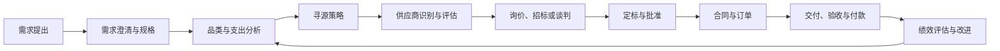

# 采购流程

采购流程的核心不是步骤数量，而是每个阶段都把一个模糊需求转化为更明确的决策。

## 主线

## 各阶段的控制点

| 阶段 | 关键输入 | 关键输出 | 失控信号 |
|---|---|---|---|
| 需求 | 业务目标、现有方案、预算 | 需求说明与规格 | 需求是“指定品牌”而非业务问题 |
| 品类 | 支出、供应市场、使用部门 | 策略与计划 | 所有品类使用同一采购方式 |
| 寻源 | 供应市场地图、准入门槛 | 长名单与短名单 | 只看熟悉供应商 |
| 评估 | 能力、质量、交付、成本、风险 | 评估结论 | 用打分表掩盖关键否决项 |
| 定价 | TCO、成本结构、市场基准 | 合理价格与条款 | 只比较首次报价 |
| 合同 | 需求、谈判结果、风险条款 | 可履行合同 | 合同与订单口径不一致 |
| 执行 | 订单、交付计划、验收标准 | 合格交付与付款 | 验收后才暴露变更 |
| 绩效 | 质量、交付、成本、创新、ESG | 改善或退出决定 | KPI 只留在采购部 |

## 需求到付款的简化

**Source-to-Contract**：

- 需求与支出分析；
- 市场与供应商研究；
- 寻源、谈判、合同。

**Procure-to-Pay**：

- 请购与审批；
- 订单与收货；
- 发票匹配与付款。

前者决定“是否买对”，后者决定“是否买得顺”。很多企业只优化 P2P 效率，却没有 S2C 策略，结果是更快地执行了错误的采购。

## RACI 建议

- 使用部门：需求责任人；
- 采购：流程、市场与供应商责任人；
- 技术/质量：规格与验收责任人；
- 财务：预算、付款与成本责任人；
- 法务：合同与合规责任人；
- 业务负责人：重大取舍的批准人。

## 连接

- [[20_采购管理/第01章-采购需求]]
- [[20_采购管理/第02章-品类管理]]
- [[20_采购管理/第03章-寻源管理]]
- [[20_采购管理/第08章-合同管理]]
- [[20_采购管理/采购绩效指标]]
- [[40_供应链运作/订单到收款]]

## 来源

综合自 [[90_来源与维护/来源档案/采购管理来源]] 第 1-9 章，以及 [[90_来源与维护/来源档案/供应链运作来源]] 第 7 章。

