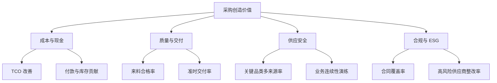

# 采购绩效指标

采购指标应回答三个问题：是否买对、是否买好、是否可持续。

## 核心指标表

| 维度 | 指标 | 定义/口径 | 常见失真 |
|---|---|---|---|
| 成本 | TCO 改善额 | 基准 TCO 与实施后差额 | 只算价格节省，忽略新增库存 |
| 成本 | 预算达成率 | 实际支出/预算 | 年底突击花预算或压供应商 |
| 效率 | P2P 周期 | 请购到付款的实际时间 | 把审批等待排除在外 |
| 合规 | 合同覆盖率 | 有有效合同的支出占比 | 合同存在但未按合同执行 |
| 合规 | 计划外采购率 | 未走采购流程的支出占比 | 拆分订单规避审批 |
| 质量 | 来料合格率 | 合格批次/检验批次 | 抽样方案过松或漏检 |
| 交付 | 准时交付率 | 按承诺日期和数量交付的比例 | 随意调整承诺日期 |
| 供应 | 单一来源依赖 | 单一来源支出/总支出 | 只看数量，不看关键性 |
| 风险 | 高风险供应商占比 | 高风险评级供应商支出占比 | 风险评级长期不更新 |
| 能力 | 供应商发展项目数 | 有目标和验证的改善项目数 | 只统计活动，不验证结果 |
| ESG | 合规供应商采购占比 | 通过 ESG/合规审核的供应商支出占比 | 审核文件过期 |

## 指标树

## 指标设计检查

- 指标是否能被采购影响，但不把端到端责任全部推给采购？
- 数据能否自动获取，定义是否稳定？
- 是否存在指标之间的反向激励？
- 指标是否覆盖关键品类，而非全部平均？
- 是否同时看结果、过程和能力建设？

## 连接

- [[20_采购管理/第09章-采购与供应商绩效]]
- [[50_组织与领导力/组织绩效指标]]
- [[60_诊断工具/指标体系树]]
- [[20_采购管理/总拥有成本TCO]]

## 来源

主要依据 [[90_来源与维护/来源档案/采购管理来源]] 第 9 章，并融合 [[90_来源与维护/来源档案/供应链领导力来源]] 第 7 章。

