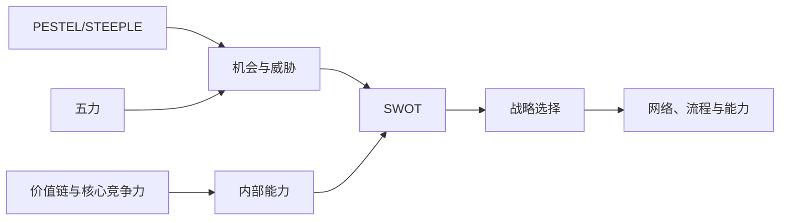

# 供应链环境分析

## 工具如何配合

## PESTEL/STEEPLE

从政治、经济、社会、技术、环境、法律和伦理等维度识别宏观变化。重点不是列清单，而是判断哪些变化会改变需求、成本、供应或合规边界。

## 波特五力

- 现有竞争者；
- 新进入者威胁；
- 替代品威胁；
- 供应商议价能力；
- 买方议价能力。

在采购中可进一步转化为供应市场吸引力和采购方议价能力判断，但不能机械地把所有供应商都视为对手。

## SWOT

优势、劣势、机会、威胁。好的 SWOT 必须具体、可验证，并连接到战略动作。例如“供应网络集中”是事实，是否构成劣势取决于中断概率与企业承受能力。

## 组合与生命周期工具

- 波士顿矩阵：按市场增长与相对份额配置产品组合；
- ADL/利特尔矩阵：按行业成熟度和竞争地位判断战略；
- 产品生命周期：引入、成长、成熟、衰退阶段对应不同供应链。

## 核心竞争力与价值链

核心竞争力应满足有价值、稀缺、难模仿和可组织利用。价值链帮助识别哪些活动创造差异化，哪些适合外包。

## 标杆分析

不仅寻找“谁做得更好”，还要理解绩效差距的机制、可比性和迁移条件。直接复制数字容易，复制能力困难。

## 连接

- [[30_供应链规划/第01章-供应链环境与战略]]
- [[10_框架/战略匹配]]
- [[20_采购管理/第04章-全球采购]]
- [[30_供应链规划/可持续供应链]]

## 来源

主要依据 [[90_来源与维护/来源档案/供应链规划来源]] 第 1 章，部分矩阵说明来自 [[90_来源与维护/来源档案/供应链领导力来源]] 第 2 章。

