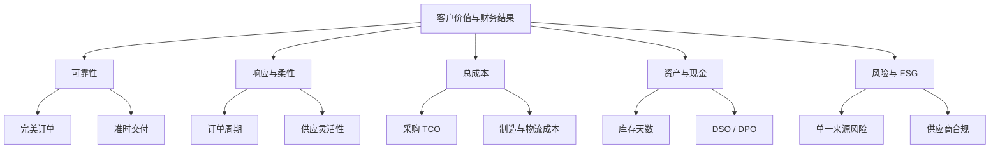

# 指标体系树

## 从战略到行动

## 每个指标必须写清

- 目的；
- 公式；
- 数据源；
- 频率；
- 责任人；
- 目标与阈值；
- 反向激励；
- 改善动作。

## 防止指标操纵

| 风险 | 检查 |
|---|---|
| 修改承诺日期 | 保留原始承诺和变更记录 |
| 缺货不计入需求 | 区分未满足需求与零需求 |
| 压货给渠道 | 跟踪终端售出与渠道库存 |
| 降本转移库存 | 使用 TCO 与全链库存 |
| 延迟维修提高利用率 | 同时看可靠性和维护 |
| 只审文件不看现场 | 质量/ESG 审核包含证据和抽样 |

## 指标数量

管理层仪表盘建议 8-15 个关键指标，流程和岗位再向下分解。指标过多会导致注意力稀释和责任模糊。

## 连接

- [[10_框架/SCOR模型]]
- [[50_组织与领导力/组织绩效指标]]
- [[20_采购管理/采购绩效指标]]
- [[50_组织与领导力/第07章-组织绩效管理]]

## 来源

综合自 [[90_来源与维护/来源档案/供应链领导力来源]] 第 7 章和 [[90_来源与维护/来源档案/采购管理来源]] 第 9 章。

