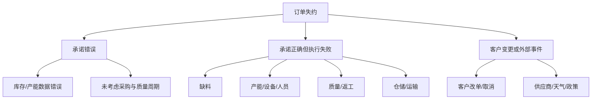

# 订单交付诊断

## 时间线

对一个失约订单记录：

1. 订单到达；
2. 信用/商务确认；
3. 可用库存或产能确认；
4. 采购/生产释放；
5. 物料齐套；
6. 生产完成；
7. 质量放行；
8. 拣货/发运；
9. 客户收货/验收；
10. 开票/收款。

## 原因树

## 关键事实

- 原始承诺日期与每次变更记录；
- 订单优先级规则；
- 齐套率；
- 生产开始与完成偏差；
- 检验等待与不合格；
- 发运延迟；
- 客户验收与拒收；
- 责任部门和改善动作。

## 指标

- 完美订单满足率；
- 按时交付率；
- 订单周期；
- 变更率；
- 失约原因占比；
- 加急订单占比与成本；
- 承诺准确率。

## 改善优先级

若承诺错误占主导，先修数据、ATP/CTP 和计划规则；若执行失败占主导，先修齐套、产能、质量和物流；若外部事件占主导，先修风险预警和客户沟通。

## 连接

- [[40_供应链运作/第02章-客户需求与交付]]
- [[40_供应链运作/订单到收款]]
- [[30_供应链规划/S&OP与IBP]]
- [[60_诊断工具/端到端诊断问题库]]

## 来源

综合自 [[90_来源与维护/来源档案/供应链运作来源]] 第 2 章和 [[90_来源与维护/来源档案/供应链领导力来源]] 第 7 章。

