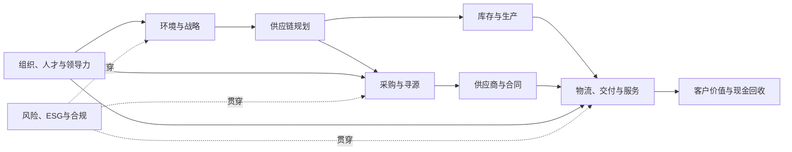

# 雨月的供应链学习库

这不是一组孤立的读书笔记，而是一套会持续编译的供应链操作系统：**战略决定取舍，规划协调供需，采购组织外部资源，运作把计划变成交付，领导力让跨组织协作真正发生。**

## 从这里开始

- 想先看全局：[[00_导航/学习地图]]
- 想按图浏览：[[00_导航/知识地图]]
- 想制定学习计划：[[00_导航/四周学习路径]]
- 想准备 SCMP：[[00_导航/认证备考导航]]
- 想核对教材覆盖：[[90_来源与维护/教材完整度总表]]
- 想解决实际问题：[[60_诊断工具/端到端诊断问题库]]
- 想查所有页面：[[index]]

## 一张图看懂知识库

## 六条主线

1. **端到端框架**：从 [[10_框架/端到端供应链]]、[[10_框架/SCOP模型]] 和 [[10_框架/SCOR模型]] 建立共同语言。
2. **采购专业线**：从 [[20_采购管理/采购管理MOC]] 进入需求、品类、寻源、谈判、合同与绩效。
3. **规划专业线**：从 [[30_供应链规划/供应链规划MOC]] 进入战略、网络、S&OP、成本、金融与数字化。
4. **运作专业线**：从 [[40_供应链运作/供应链运作MOC]] 进入订单、库存、物流、生产、服务与质量。
5. **组织领导线**：从 [[50_组织与领导力/领导力MOC]] 进入战略承接、组织设计、人才、伙伴关系、协同与风险。
6. **诊断与行动**：用 [[60_诊断工具/指标体系树]] 找问题，用 [[80_模板/品类策略画布]]、[[80_模板/S&OP会议模板]] 和 [[80_模板/决策纪要模板]] 把判断落地。

## 这个知识库怎么用

> [!tip] 学习时
> 先读框架页，再按领域 Hub 进入章节页。每章只记“问题、模型、指标、误区、连接”，不要把书页搬进笔记。

> [!question] 问答时
> 从 `index.md` 定位页面，再回到来源页核对页码和语境。好的问答结论应回写为新页面，而不是停留在聊天记录里。

> [!todo] 实战时
> 先用诊断问题界定问题，再选框架。模板只负责结构化思考，不替你完成判断。

## 知识库的边界

当前知识主要由 4 本 SCMP 教材编译而成，覆盖供应链通识、采购、规划、运作和组织领导力。四本教材的 34 个章节均已升级为自足精读版，共 634 道章节自测题，并保留 1,263 页 OCR 全文底稿。逐章验收见 [[90_来源与维护/教材完整度总表]]。

它仍不等于全部供应链知识：物流、计划管理等 SCMP 选修模块只有交叉内容，没有完整纳入；通过考试还需要官方大纲和模拟题校验。新增来源时请遵循 [[90_来源与维护/维护规范]]。

